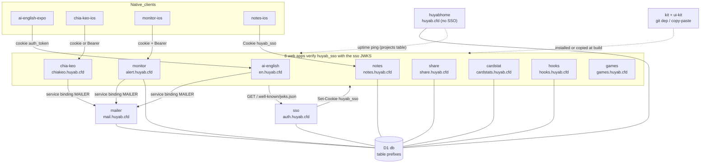
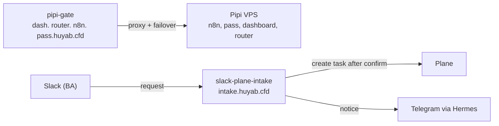

# huyab.cfd ecosystem map (diagram + endpoints)

Mirror of the "Huyab Ecosystem Map" artifact: https://claude.ai/artifact/9PQABvHZ7Ph2jEV3v4fCMc

Source of truth is [ECOSYSTEM.md](ECOSYSTEM.md) (evidence per edge, per-repo details,
contracts). This page only draws it and lists the endpoints. When `ECOSYSTEM.md`
changes, update this page and the artifact in the same change.

## 1. Main diagram

Solid arrows are runtime calls, dashed arrows are pings or shared code.

Mailer also verifies the cookie, for its log page. Native clients log in through
a WebView on `sso`.

## 2. Other repos

Repos with no edges to the diagrams above: `badminton` (SSO gate), `digest-vote`
(KV `VOTES`), `runlater` (no route, GitHub webhook queue), `resume`, `xo-expo`,
`dev-notes`.

Own D1 databases, not in the shared `db`: `stitch-db` (ai-english), `chiakeo-db`
(chia-keo), `runlater`.

## 3. Endpoints

| Repo | Endpoint | Callers and auth |
| --- | --- | --- |
| sso | `auth.huyab.cfd` `/login?redirect_uri=` `/logout` `/me` `/.well-known/jwks.json` | Every web app and the 3 iOS apps. Cookie `huyab_sso`, Domain `.huyab.cfd`, RS256, 24 h. `/me` is server-side only. |
| mailer | `POST /send` (service binding `MAILER`), `GET /` log page | ai-english, chia-keo, monitor. `Authorization: Bearer MAILER_KEY`. Log page needs SSO as the admin email. |
| ai-english | `en.huyab.cfd` `/api/auth/google` `/api/auth/me` | ai-english-expo via cookie `auth_token` (exchanged from `huyab_sso`). Calls mailer and Workers AI, cron 13:30 for streak reminders. |
| chia-keo | `chiakeo.huyab.cfd` `/api/*` `/api/mcp` `/api/version` `/api/health` | chia-keo-ios with cookie or SSO Bearer. Claude MCP clients with `ck_...` tokens. better-auth runs in parallel with SSO. Own D1 `chiakeo-db`. |
| notes | `notes.huyab.cfd` | notes-ios sends `Cookie: huyab_sso`. Cookie only, no Bearer. |
| monitor | `alert.huyab.cfd` | monitor-ios with cookie + Bearer (server reads only the cookie). Calls Odoo over JSON-RPC, cron every minute, mails through mailer. |
| share | `share.huyab.cfd` + MCP + skill | AI agents with the SSO cookie, or Bearer master password + `X-Email`. |
| cardstat | `cardstats.huyab.cfd` | SSO cookie. Nobody calls it. |
| hooks | `hooks.huyab.cfd/hook/...` | External systems post webhooks (public). UI uses cookie `access_token` or SSO. Durable Object `EndpointHub`. |
| games | `games.huyab.cfd` | Optional SSO for history. Durable Objects, no D1. |
| huyabhome | `huyab.cfd` `/api/projects-status` | No SSO. Pings every app in the D1 `projects` table. |
| pipi-gate | `dash.` `router.` `n8n.` `pass.huyab.cfd` | SSO + email allow-list in front of the Pipi tunnel, failover for n8n and pass. |
| slack-plane-intake | `intake.huyab.cfd` | Slack requests become Plane tasks after a confirm on its UI. Notices go to Telegram (Hermes). Container on pipi. |
| badminton | `badminton.huyab.cfd` | SSO gate. Fund and sessions of two badminton groups. |
| digest-vote | `digest.huyab.cfd` | Votes on the morning digest, stored in KV `VOTES`. |
| runlater | no route | Job queue fed by GitHub webhooks, a runner pulls jobs. Own D1 `runlater`. |
| resume | `resume.huyab.cfd` `cv.huyab.cfd` | Static CV, no dependencies. |

Worker names differ from repo names in three places: `chia-keo` is worker `chiakeo`,
`hooks` is `webhook-tester`, `games` is `pikachu-online`. Service bindings use the
worker name.
